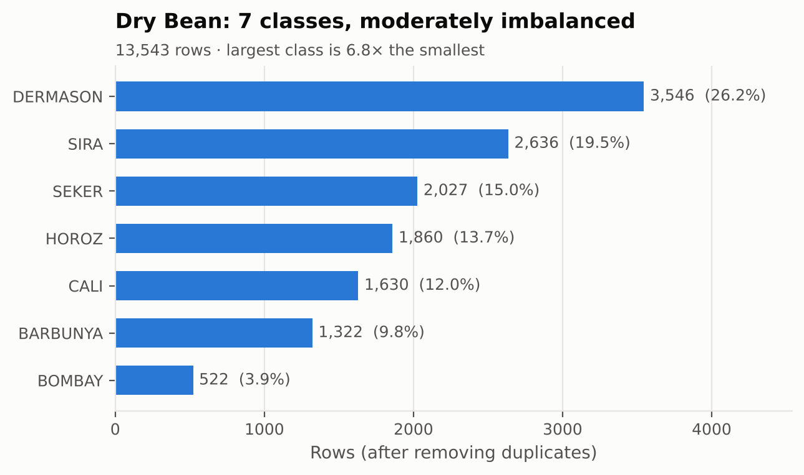
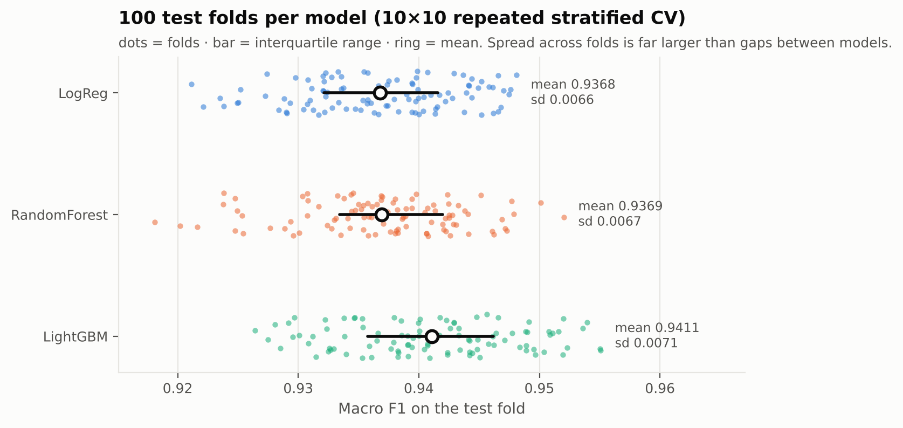
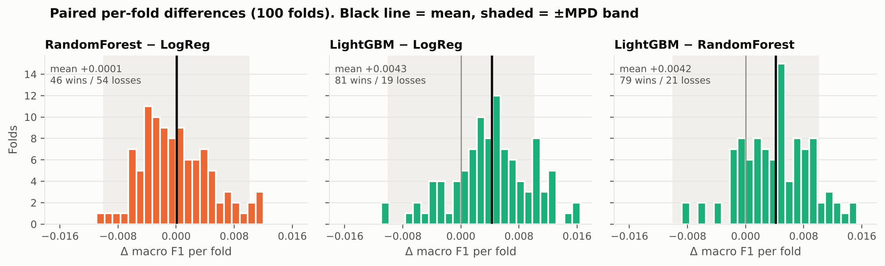
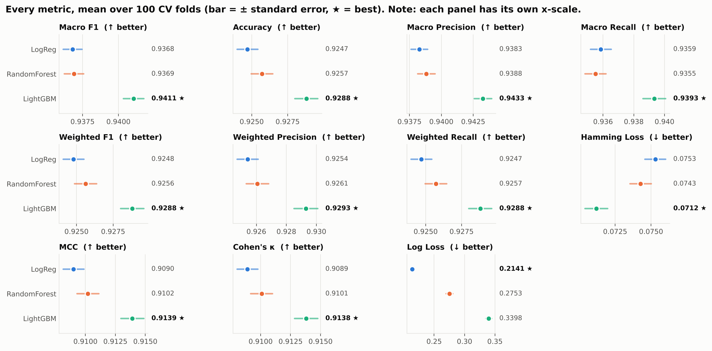
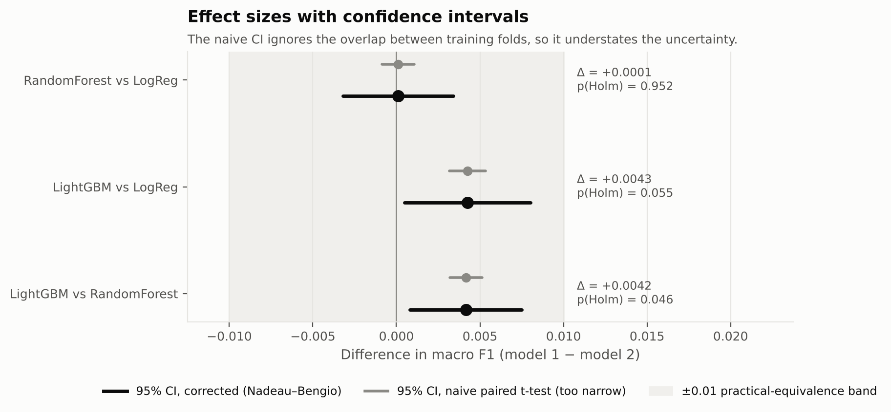
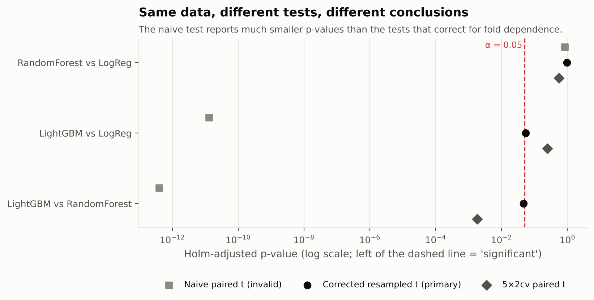
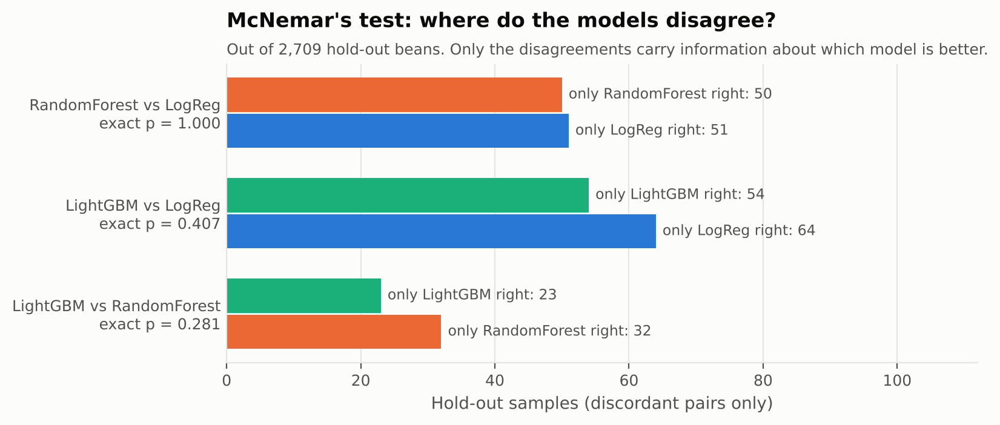
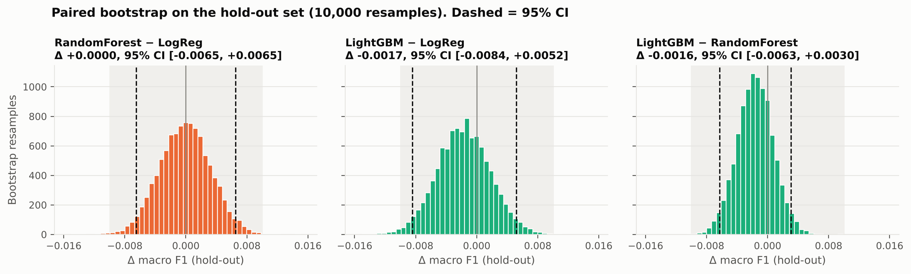
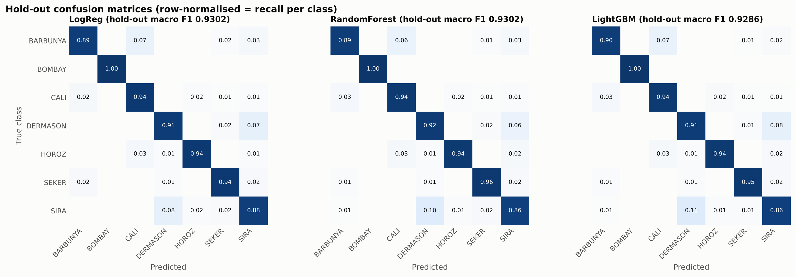
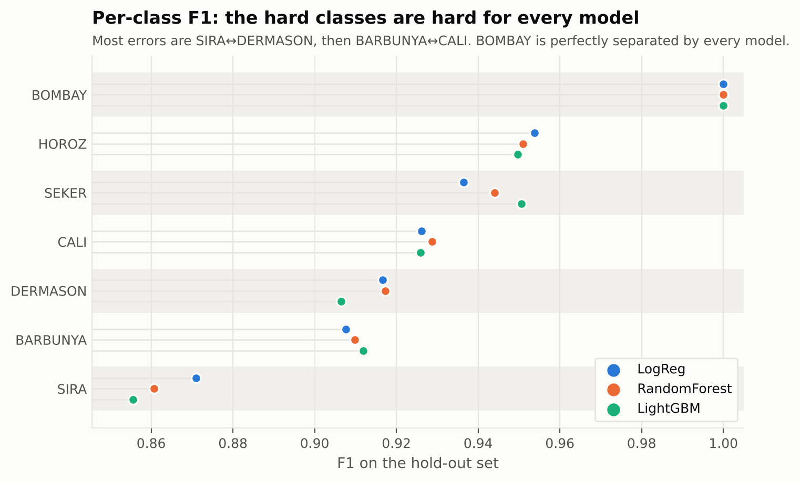

# A/B Testing ML Models the Right Way: LogReg vs Random Forest vs LightGBM

**An end-to-end, pre-registered statistical comparison of three classifiers on the Dry Bean
multi-class benchmark.** It uses 11 metrics and 5 statistical tests, and shows why the most
common way of comparing models (a paired t-test on CV folds) gets the answer wrong.

| | |
|---|---|
| **Dataset** | [Dry Bean (UCI #602)](https://archive.ics.uci.edu/dataset/602/dry+bean+dataset): 13,543 beans, 16 shape features, 7 classes |
| **Arms** | **A** Logistic Regression (control) · **B** Random Forest · **C** LightGBM |
| **Primary metric** | Macro F1 (pre-registered) |
| **Tests** | Corrected resampled t-test (primary) · 5×2cv t / F · McNemar · paired bootstrap · TOST equivalence · Holm correction |
| **Decision threshold** | Significant (Holm α = 0.05) **and** ≥ 1 pp macro-F1 improvement |
| **Docs** | [Plan](docs/PLAN.md) · [Methodology](docs/METHODOLOGY.md) · [Work log](docs/WORKLOG.md) · [Blog post](docs/BLOG_POST.md) · [Notebook](notebooks/analysis.ipynb) |

---

## TL;DR

1. **All three models are practically equivalent on macro F1.** The 90% CI of every pairwise
   difference lies inside ±1 pp (TOST, p ≤ 0.002 for all three pairs).
2. **LightGBM has a small but real edge in cross-validation**: +0.42 pp macro F1.
   - vs Random Forest it is statistically significant (Holm p = 0.046) and confirmed by 5×2cv (Holm p = 0.002).
   - vs Logistic Regression it narrowly misses significance (Holm p = 0.055).
   - In both cases it is **well under the 1 pp threshold**, and it **did not reproduce on the hold-out
     set**, where LightGBM came last (not significantly).
3. **Logistic Regression has the best-calibrated probabilities by far**: log loss 0.214 vs
   0.275 (RF) and 0.340 (LightGBM), significant for every pair. It is also about 70× faster to train than RF.
4. **A naive paired t-test would have declared LightGBM the clear winner** (p ≈ 10⁻¹¹),
   because it ignores the correlation between CV folds. The corrected test raises the
   p-value by about ten orders of magnitude.

> **Recommendation: ship Logistic Regression.** Under the pre-registered rule, no
> challenger clears the "significant **and** ≥ 1 pp" bar, so we fall back to the simplest,
> fastest and best-calibrated model.

---

## 1. Experimental design

Everything below was fixed in [`docs/PLAN.md`](docs/PLAN.md) **before** any model was trained.

```
13,611 raw rows → drop 68 exact duplicates → 13,543 rows
   └─ stratified 80/20 split (seed 42)
        ├─ Dev set (10,834) ─► 10×10 repeated stratified CV ─► corrected t-test, TOST, naive t (demo)
        │                    └► 5×2 stratified CV            ─► Dietterich t, Alpaydin F
        └─ Hold-out (2,709) ─► touched once                  ─► McNemar, paired bootstrap
```

| Arm | Model | Hyperparameters (fixed, untuned) |
|---|---|---|
| A (control) | Logistic Regression | StandardScaler → multinomial LR, C = 1, lbfgs |
| B | Random Forest | 500 trees, `max_features='sqrt'` |
| C | LightGBM | 400 trees, lr 0.05, 31 leaves, subsample 0.8, colsample 0.8 |

- **Paired design:** every model is trained and scored on identical folds, so we test the
  *per-fold difference*. That removes fold difficulty, which is the largest source of variance.
- **No leakage:** duplicates are removed before splitting (all 68 were HOROZ beans), and
  scaling is fitted inside each training fold via `Pipeline`.
- **Hypotheses:** H₀: equal mean macro F1 vs H₁: different (two-sided), for B vs A, C vs A and C vs B.
- **Decision rule:** prefer a challenger only if Holm-adjusted p < 0.05 **and** Δ ≥ 0.01.
  If the models are TOST-equivalent within ±0.01, prefer the simpler or cheaper model.



## 2. Results: cross-validated performance

Mean ± sd over 100 test folds (10×10 repeated stratified CV). **Bold** marks the best value.

| Metric | LogReg | RandomForest | LightGBM |
|---|---|---|---|
| **Macro F1** (primary) | 0.9368 ± 0.0066 | 0.9369 ± 0.0067 | **0.9411 ± 0.0071** |
| Accuracy | 0.9247 ± 0.0072 | 0.9257 ± 0.0075 | **0.9288 ± 0.0080** |
| Macro Precision | 0.9383 ± 0.0065 | 0.9388 ± 0.0068 | **0.9433 ± 0.0069** |
| Macro Recall | 0.9359 ± 0.0067 | 0.9355 ± 0.0069 | **0.9393 ± 0.0074** |
| Weighted F1 | 0.9248 ± 0.0072 | 0.9256 ± 0.0075 | **0.9288 ± 0.0079** |
| Hamming Loss ↓ | 0.0753 ± 0.0072 | 0.0743 ± 0.0075 | **0.0712 ± 0.0080** |
| MCC | 0.9090 ± 0.0087 | 0.9102 ± 0.0091 | **0.9139 ± 0.0096** |
| Cohen's κ | 0.9089 ± 0.0087 | 0.9101 ± 0.0091 | **0.9138 ± 0.0096** |
| Log Loss ↓ | **0.2141 ± 0.0210** | 0.2753 ± 0.0541 | 0.3398 ± 0.0492 |
| Fit time per fold | **0.15 s** | 11.2 s | 3.7 s |

> **About Hamming Loss:** in single-label multi-class classification, Hamming Loss is
> *exactly* 1 − accuracy (the notebook checks this: max deviation 0). It only adds
> information in multi-label problems, so it isn't counted as separate evidence here.



The fold-to-fold spread (sd ≈ 0.007) is larger than the gap between models (≤ 0.004).
Comparing *unpaired* means would be hopeless. The paired differences tell the real story:





## 3. Statistical tests on the primary metric (macro F1)

| Comparison | Δ macro F1 | 95% CI (corrected) | d_z | Wins | p (corrected) | **p Holm** | p 5×2cv (Holm) | p 5×2 F (Holm) | p naive (Holm) |
|---|---|---|---|---|---|---|---|---|---|
| RF vs LogReg | +0.0001 | [−0.0032, +0.0034] | 0.02 | 46/100 | 0.952 | **0.952** | 0.553 | 0.129 | 0.833 |
| LightGBM vs LogReg | +0.0043 | [+0.0005, +0.0080] | 0.78 | 81/100 | 0.027 | **0.055** | 0.245 | 0.337 | 1.3 × 10⁻¹¹ |
| LightGBM vs RF | +0.0042 | [+0.0008, +0.0075] | 0.86 | 79/100 | 0.015 | **0.046** | 0.002 | 0.0005 | 4.0 × 10⁻¹³ |



**What the table says:**
- **RF vs LogReg:** essentially identical (Δ = +0.0001, RF wins 46 of 100 folds).
- **LightGBM vs LogReg:** LightGBM wins 81 of 100 folds, but the corrected test (Holm p = 0.055)
  and both 5×2cv tests stay above α. The uncorrected 95% CI excludes 0, but the comparison
  does not survive the family-wise correction.
- **LightGBM vs RF:** significant under the primary test (Holm p = 0.046), and both 5×2cv
  variants agree. This is the one statistically real difference in macro F1.

### Why the naive t-test is wrong, in one picture



The naive test treats the 100 fold scores as independent. They aren't: any two
training sets share about 89% of their rows. Its standard error is therefore about 3.5× too small,
and it reports p ≈ 10⁻¹¹ for a 0.4 pp difference. The Nadeau–Bengio correction multiplies
the variance by `(1/J + n_test/n_train)` = 0.121 instead of 1/J = 0.01. See
[METHODOLOGY.md §3–4](docs/METHODOLOGY.md#3-why-the-naive-paired-t-test-on-cv-scores-is-wrong).

### Equivalence (TOST, margin ±0.01)

| Comparison | 90% CI of Δ | TOST p | Practically equivalent? |
|---|---|---|---|
| RF vs LogReg | [−0.0027, +0.0029] | 2 × 10⁻⁸ | ✅ yes |
| LightGBM vs LogReg | [+0.0011, +0.0074] | 0.0016 | ✅ yes |
| LightGBM vs RF | [+0.0014, +0.0070] | 0.0004 | ✅ yes |

This is the key result for decision-making. **We can rule out that LightGBM is ≥ 1 pp better
than either alternative.** "Significant" and "equivalent" are not contradictory: LightGBM vs RF
is a *real but small* difference.

## 4. Hold-out set (2,709 unseen beans)

Each model was fitted once on the full dev set and scored once on the hold-out set.

| Metric | LogReg | RandomForest | LightGBM |
|---|---|---|---|
| Macro F1 | **0.9302** | **0.9302** | 0.9286 |
| Accuracy | **0.9192** | 0.9188 | 0.9155 |
| MCC | **0.9023** | 0.9018 | 0.8977 |
| Log Loss ↓ | **0.2183** | 0.2758 | 0.3814 |

| Comparison | Only model 1 right | Only model 2 right | McNemar exact p (Holm) | Δ macro F1 | Bootstrap 95% CI | Bootstrap p (Holm) |
|---|---|---|---|---|---|---|
| RF vs LogReg | 50 | 51 | 1.000 (1.000) | −0.0000 | [−0.0065, +0.0065] | 0.99 (1.00) |
| LightGBM vs LogReg | 54 | 64 | 0.407 (0.842) | −0.0017 | [−0.0084, +0.0052] | 0.63 (1.00) |
| LightGBM vs RF | 23 | 32 | 0.281 (0.842) | −0.0016 | [−0.0063, +0.0030] | 0.49 (1.00) |




The CV ranking **flips** on the hold-out set: LightGBM comes last. None of the hold-out differences is
significant, and every bootstrap CI includes 0. This is what you'd expect when the true gap (about 0.4 pp)
is smaller than the noise of a single 2.7k-sample test set (CI half-width about 0.6 pp). It is a
reminder that **one train/test split is a very weak basis for choosing a model.**

## 5. Where the errors come from




- **SIRA ↔ DERMASON** is by far the most common confusion (about 300 errors summed over the three
  models), followed by **BARBUNYA ↔ CALI**.
- **BOMBAY** (the rarest class, 3.9%) is perfectly classified by every model. Size alone separates it.
- The models trade wins on individual classes: LightGBM is best on SEKER, and LogReg is best on SIRA and HOROZ.
  No model dominates. Most remaining errors come from a genuinely hard boundary in the feature space.

## 6. Secondary metrics (exploratory)

The same corrected t-test was applied to every metric, with Holm correction within each metric
(full table: [`results/stat_tests_secondary_metrics.csv`](results/stat_tests_secondary_metrics.csv)):

- **Log loss is the only metric where differences are large and unambiguous.** LogReg beats
  RF (Holm p = 4 × 10⁻⁴) and LightGBM (p ≈ 4 × 10⁻¹⁵), and RF beats LightGBM (p = 10⁻⁴). The tree models,
  especially boosting with 400 rounds, produce over-confident probabilities. If downstream use needs
  probabilities (thresholds, expected costs, ranking), this matters more than a 0.4 pp F1 gap.
- Macro precision: LightGBM is significantly higher than both (Holm p = 0.033), at about +0.5 pp.
- Macro recall, accuracy, weighted F1/P/R, MCC, κ and Hamming loss: no significant differences
  (all Holm p ≥ 0.07; accuracy-type metrics all ≥ 0.18).

These are *exploratory*. The decision rests on the pre-registered primary metric.

## 7. Decision

| Comparison | Statistically significant? | ≥ 1 pp? | TOST-equivalent? | Verdict |
|---|---|---|---|---|
| RF vs LogReg | ❌ (p = 0.95) | ❌ | ✅ | Practically equivalent |
| LightGBM vs LogReg | ❌ (p = 0.055) | ❌ | ✅ | Practically equivalent |
| LightGBM vs RF | ✅ (p = 0.046) | ❌ | ✅ | LightGBM is better, but by < MPD → practically equivalent |

**No challenger beats the control by a practically meaningful margin.** Following the
pre-registered rule, choose the simplest and cheapest model: **Logistic Regression**. It also
has clearly better-calibrated probabilities, trains in a fraction of a second, and has
interpretable coefficients.

*When would the answer change?* If a 0.4 pp gain in macro F1 is worth more than calibration and
simplicity in your context, lower the MPD and LightGBM would win against RF. That is a business
decision, and it should be made **before** looking at the data, which is why it was fixed in advance.

## 8. Limitations

- **One dataset.** The conclusions are about Dry Bean, not about these algorithms in general.
  Ranking algorithms across many datasets calls for Friedman + Nemenyi tests (Demšar, 2006).
- **No hyperparameter tuning.** Tuned RF or LightGBM (or a calibrated LightGBM) might change the picture.
  Fair tuning needs nested CV, which costs about 10× the compute.
- **The corrected t-test is a heuristic.** Its correction factor is approximate (Bouckaert &
  Frank, 2004 found it well-behaved in practice). That's why 5×2cv is reported as a second opinion.
- **Single hold-out split.** McNemar and the bootstrap describe one sample of test data.
- **Several test families.** Holm is applied within each family (CV tests, hold-out tests,
  each secondary metric), not across all of them.

## 9. Reproduce

```bash
git clone https://github.com/akhilnathreddy/ml-ab-testing && cd ml-ab-testing
make setup       # virtualenv + pinned dependencies
make test        # 16 unit tests for the statistics code (incl. exact match vs mlxtend)
make run         # downloads data (SHA-256 verified), runs everything (about 8 min on 4 cores)
make notebook    # executes notebooks/analysis.ipynb against the cached results
```

All randomness is seeded (`SEED = 42` in [`src/abtest/config.py`](src/abtest/config.py)). Two
independent full runs produced byte-identical result tables.

## 10. Repository layout

```
├── README.md                     ← this report
├── docs/
│   ├── PLAN.md                   ← pre-registered design (written before training)
│   ├── METHODOLOGY.md            ← why each test, formulas, references
│   ├── WORKLOG.md                ← dated log of progress and decisions
│   └── BLOG_POST.md              ← Medium-ready write-up
├── src/abtest/
│   ├── config.py                 ← every experimental constant
│   ├── data.py                   ← download, checksum, dedupe, split
│   ├── models.py                 ← the three arms
│   ├── metrics.py                ← 11 metrics + fast macro-F1 for bootstrap
│   ├── stats_tests.py            ← corrected t, 5×2cv, McNemar, bootstrap, TOST, Holm
│   ├── experiment.py             ← CV engine, tests, decision rule, outputs
│   └── plots.py                  ← report figures
├── scripts/run_experiment.py     ← CLI entry point
├── notebooks/analysis.ipynb      ← executed walkthrough
├── tests/test_stats.py           ← unit tests
└── results/                      ← CSV/JSON outputs + figures/
```

## References

- Nadeau & Bengio (2003). *Inference for the Generalization Error.* Machine Learning 52.
- Bouckaert & Frank (2004). *Evaluating the Replicability of Significance Tests for Comparing Learning Algorithms.* PAKDD.
- Dietterich (1998). *Approximate Statistical Tests for Comparing Supervised Classification Learning Algorithms.* Neural Computation 10(7).
- Alpaydin (1999). *Combined 5×2 cv F Test for Comparing Supervised Classification Learning Algorithms.* Neural Computation 11(8).
- McNemar (1947). Psychometrika 12(2). · Schuirmann (1987), TOST. · Holm (1979), Scand. J. Statistics 6(2).
- Demšar (2006). *Statistical Comparisons of Classifiers over Multiple Data Sets.* JMLR 7.
- Koklu & Ozkan (2020). *Multiclass classification of dry beans using computer vision and machine learning techniques.* Computers and Electronics in Agriculture 174. Dataset: CC BY 4.0.
