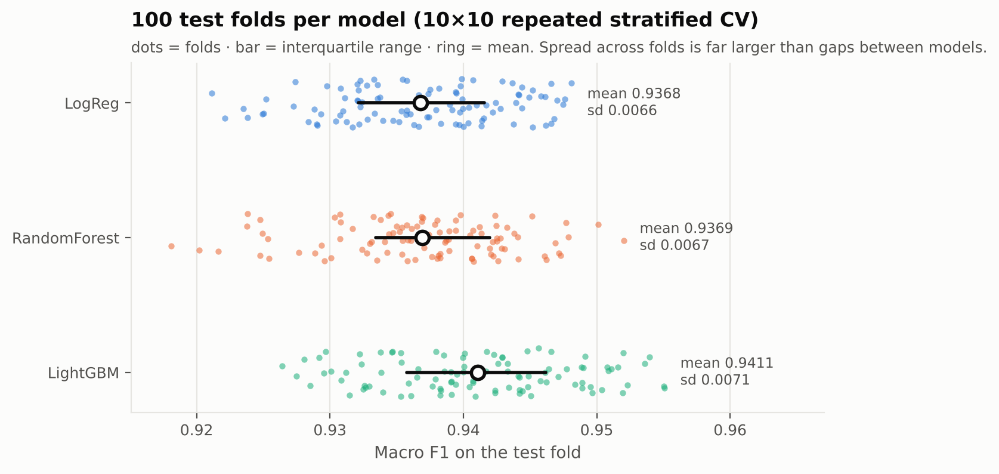
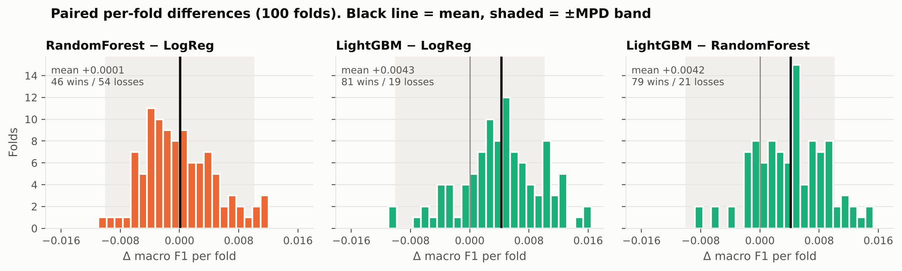
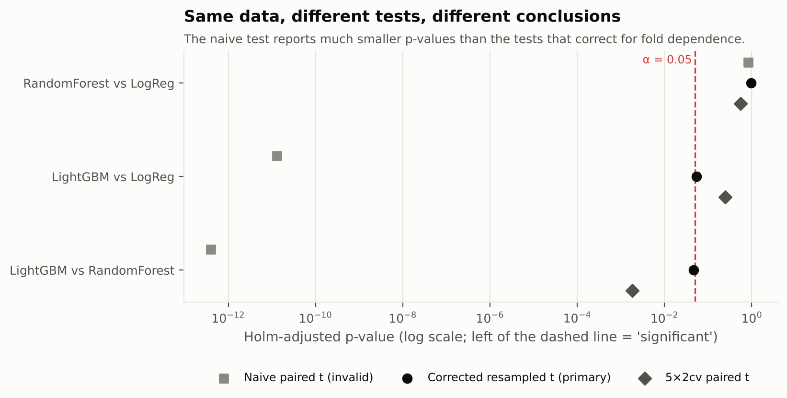
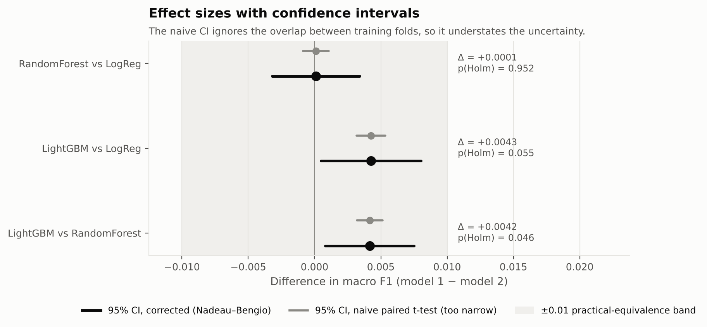
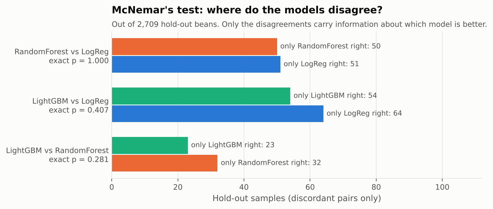

# Your Model Comparison Is Probably Lying to You: A/B Testing Classifiers the Right Way

*How a "p = 0.00000000001" win for LightGBM turned into "just ship the logistic regression."*

> **Code, data pipeline, and full report:** https://github.com/akhilnathreddy/ml-ab-testing

---

Every data team has had this conversation:

> "The new gradient-boosted model scores **94.1%** macro-F1 in cross-validation. The old
> logistic regression gets **93.7%**. And the t-test on the folds says p < 0.001. Let's ship it."

It sounds rigorous: cross-validation, a statistical test, a tiny p-value. But almost every
part of that reasoning is shaky. In this post I run a **proper A/B test between three
classifiers**, show exactly where the naive approach breaks, and end up with a very different
recommendation.

## The setup: three models, one benchmark, rules written in advance

**Dataset.** The [Dry Bean dataset](https://archive.ics.uci.edu/dataset/602/dry+bean+dataset)
(UCI) has 13,611 images of dry beans reduced to 16 shape features (area, perimeter, roundness,
…), and the task is to classify them into **7 varieties**. It's a good benchmark for this because:
- It's multi-class and **imbalanced** (the largest class is 6.8× the smallest), so macro-F1 matters.
- It isn't saturated. Unlike Iris or Wine, the models don't all score 99%, so there's
  something to test.

**The three arms:**

| Arm | Model |
|---|---|
| A, control | Logistic Regression (scaled) |
| B | Random Forest (500 trees) |
| C | LightGBM (400 boosted trees) |

**Pre-registration.** Before training anything, I wrote down the following (it's in the repo's
[`PLAN.md`](https://github.com/akhilnathreddy/ml-ab-testing/blob/main/docs/PLAN.md)):
- **Primary metric:** macro-F1
- **α:** 0.05 with Holm correction for 3 comparisons
- **Minimum difference worth caring about:** 1 percentage point
- **Decision rule:** switch from the control only if a challenger is *both* statistically
  significant *and* at least 1 pp better. If the models are provably equivalent, pick the simpler one.

This step is not bureaucracy. Without it, every number you see afterwards invites you to move the goalposts.

**One data-hygiene catch:** the raw file contains **68 exact duplicate rows**, all of them HOROZ
beans. If you don't drop them, the same bean can sit in both a training fold and a test fold,
which quietly inflates every score.

## Step 1: Cross-validate *paired*

I used 10×10 repeated stratified cross-validation on 80% of the data, which gives 100 test folds.
Crucially, **every model sees exactly the same folds.** That makes this a *paired*
experiment, like testing two drugs on the same patients.



Look at the spread. The difference *between folds* (sd ≈ 0.007) is bigger than the
difference *between models* (≤ 0.004). Comparing means alone would tell you nothing. But because
the folds are shared, we can look at the **per-fold difference**, which cancels out "this fold
was just hard":



LightGBM beats Logistic Regression on 81 of 100 folds and Random Forest on 79. Random Forest vs
Logistic Regression is a coin flip (46/54).

## Step 2: The trap, the naive paired t-test

The obvious move is `scipy.stats.ttest_rel(lgbm_scores, logreg_scores)`. Here's what it says:

| Comparison | Δ macro-F1 | Naive p (Holm) |
|---|---|---|
| LightGBM vs LogReg | +0.43 pp | **1.3 × 10⁻¹¹** |
| LightGBM vs RF | +0.42 pp | **4.0 × 10⁻¹³** |

Case closed? No. **This test is invalid for CV scores.** A t-test assumes the 100 numbers are
independent samples. But in 10-fold CV, any two training sets share about **89% of their rows**,
so the scores are strongly correlated. The test sees 100 data points when it has far less
independent information than that. The variance is underestimated, and the p-value is absurdly small.

Dietterich showed back in 1998 that this test's false-positive rate is far above 5%. Adding more
CV repeats makes it *worse*, because you can drive p toward zero just by running more folds.

## Step 3: Tests that respect the dependence

**1. The corrected resampled t-test (Nadeau & Bengio, 2003).** This is the same t-statistic, but
the variance is inflated to account for the train/test overlap:

```
t = mean(d) / sqrt( (1/J + n_test/n_train) · var(d) )
```

With J = 100 and n_test/n_train ≈ 0.111, the variance multiplier goes from 0.01 to 0.121, and
the standard error grows about **3.5×**.

**2. The 5×2cv t-test (Dietterich, 1998)** and **Alpaydin's combined F-test.** These use five repeats of 2-fold
CV. The halves don't overlap, so the Type-I error stays honest. The price is lower power.

Same data, very different conclusions:



| Comparison | Δ | 95% CI (corrected) | Corrected p (Holm) | 5×2cv p (Holm) |
|---|---|---|---|---|
| RF vs LogReg | +0.01 pp | [−0.32, +0.34] pp | 0.952 | 0.553 |
| LightGBM vs LogReg | +0.43 pp | [+0.05, +0.80] pp | **0.055** | 0.245 |
| LightGBM vs RF | +0.42 pp | [+0.08, +0.75] pp | **0.046** | 0.002 |

The ten-orders-of-magnitude "win" over Logistic Regression is gone: p = 0.055 after Holm
correction. LightGBM's edge over Random Forest survives (p = 0.046), and 5×2cv agrees.



## Step 4: "Not significant" ≠ "the same". Use an equivalence test

A non-significant result might just mean low power. To claim the models are *practically the
same*, you need to flip the hypotheses. That's **TOST** (two one-sided tests):

- H₀: the difference is at least 1 pp in either direction
- H₁: the difference is within ±1 pp

| Comparison | 90% CI | TOST p | Equivalent within ±1 pp? |
|---|---|---|---|
| RF vs LogReg | [−0.27, +0.29] pp | 2 × 10⁻⁸ | ✅ |
| LightGBM vs LogReg | [+0.11, +0.74] pp | 0.002 | ✅ |
| LightGBM vs RF | [+0.14, +0.70] pp | 0.0004 | ✅ |

This is the most useful result in the whole analysis. **We can confidently rule out that
LightGBM is ≥ 1 pp better than either alternative.** It is also *not* a contradiction that LightGBM vs RF
is both "significant" and "equivalent". The difference is real, and it is small.

## Step 5: The hold-out set, and a ranking that flips

The remaining 20% (2,709 beans) was untouched until the very end. I fit each model once and ran two tests:

- **McNemar's test** looks only at beans where the two models *disagree*. If neither model is
  better, a disagreement should be equally likely to go either way.
- **Paired bootstrap:** resample the test set 10,000 times and recompute the macro-F1 difference each time.



| | LogReg | RF | LightGBM |
|---|---|---|---|
| Hold-out macro-F1 | **0.9302** | **0.9302** | 0.9286 |

**LightGBM came last.** None of the differences is significant (McNemar p = 0.28–1.0), and every
bootstrap CI contains zero. That's no paradox. A 2.7k-sample test set has a macro-F1 noise
band of about ±0.6 pp, which is larger than the true gap of about 0.4 pp. **If you choose models
from a single train/test split, you're partly choosing by coin flip.**

## Step 6: Look beyond the primary metric

I ran the corrected test on all 11 metrics as an exploratory analysis. One stood out:

| | LogReg | RF | LightGBM |
|---|---|---|---|
| **Log loss** ↓ | **0.214** | 0.275 | 0.340 |

All three pairwise log-loss differences are highly significant. The tree ensembles, especially
boosting, are **over-confident**. If anything downstream uses the probabilities (thresholds,
expected-cost decisions, ranking), that matters far more than 0.4 pp of F1.

And, as the brief asked, **Hamming Loss**: for single-label multi-class it is *identically*
1 − accuracy (0.0753 vs 0.9247). Report it, but don't count it as separate evidence.

## The verdict

| | Significant? | ≥ 1 pp? | Equivalent? | Verdict |
|---|---|---|---|---|
| RF vs LogReg | ❌ | ❌ | ✅ | equivalent |
| LightGBM vs LogReg | ❌ (0.055) | ❌ | ✅ | equivalent |
| LightGBM vs RF | ✅ (0.046) | ❌ | ✅ | real but too small to matter |

**Ship the Logistic Regression.** It is practically as accurate as the alternatives, has the best-calibrated
probabilities, trains about 70× faster than the forest, and you can read its coefficients.

## Five takeaways for your next model comparison

1. **Write the decision rule first:** the metric, α, and the smallest difference you care about.
2. **Pair your comparisons.** Same folds for every model, and test the differences.
3. **Never run a plain t-test on CV folds.** Use the Nadeau–Bengio correction or 5×2cv.
4. **Separate "significant" from "meaningful."** Add an equivalence test, and correct for multiple comparisons.
5. **Look at calibration and cost**, not just the headline score.

All code is open source, with unit tests that check the statistics against
`mlxtend` and `scipy`: **https://github.com/akhilnathreddy/ml-ab-testing**

---

### References

- Nadeau & Bengio (2003), *Inference for the Generalization Error*, Machine Learning 52.
- Bouckaert & Frank (2004), *Evaluating the Replicability of Significance Tests for Comparing Learning Algorithms*, PAKDD.
- Dietterich (1998), *Approximate Statistical Tests for Comparing Supervised Classification Learning Algorithms*, Neural Computation 10(7).
- Alpaydin (1999), *Combined 5×2 cv F Test*, Neural Computation 11(8).
- Demšar (2006), *Statistical Comparisons of Classifiers over Multiple Data Sets*, JMLR 7.
- Koklu & Ozkan (2020), *Multiclass classification of dry beans…*, Computers and Electronics in Agriculture 174.
